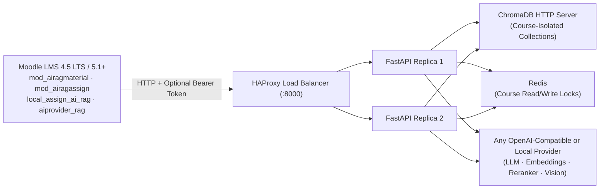

# RAGrader

[](https://github.com/glennhkm/RAGrader/actions/workflows/ci.yml)

An open-source **Retrieval-Augmented Generation (RAG)** assistant for grading essays and short answers. RAGrader retrieves passages from the course materials a teacher uploads (PDF, PPTX, DOCX, TXT), then suggests a score, feedback, citations and a confidence value **for a teacher to review**.

- **Moodle plugins** (4.5 LTS / 5.1+), an LMS-agnostic `/v1` REST API and a CLI.
- **Any model platform:** cloud (Groq, OpenRouter, OpenAI, HuggingFace, …), any OpenAI-compatible server (Ollama, vLLM, LM Studio, llama.cpp, LiteLLM, TEI), or in-process local models.
- **Guardrails:** scoped retrieval per course, citations checked against the retrieved text, and warnings on suspected prompt injection.
- **Measured:** an offline evaluation harness, with published reports that include the weak spots.

> RAGrader is a grading **assistant**, not a replacement for a teacher. In `mod_airagassign`, AI scores stay suggestions until a teacher confirms them.

## How well does it grade?

Measured with `openai/gpt-oss-120b` and `baai/bge-m3` on 3,167 English short answers (2026-11-24 and 2026-11-25), 1,999 of them in the test sets shown here. Score thresholds were fitted on separate dev data, once per configuration. Brackets are 95% confidence intervals.

| Test set | Answers | QWK | Accuracy (3 classes) | QWK without materials |
|---|---:|---:|---:|---:|
| EngSAF | 996 | **0.679** [0.582, 0.765] | 67.5% | 0.384 |
| SciEntsBank, unseen questions | 598 | **0.726** [0.619, 0.799] | 68.6% | 0.589 |
| SciEntsBank, unseen answers | 405 | **0.714** [0.642, 0.775] | 71.6% | 0.501 |

Where it is still weak:

- **Partially correct answers:** recognised 60% of the time on EngSAF and 31–32% on SciEntsBank.
- **Confidence is not calibrated:** expected calibration error is 0.23–0.26, so do not use it to skip review.
- **Repeatability:** 85–88% of 100 dev answers kept the same label over three runs.
- **Prompt injection:** all three tested patterns were always flagged, but the label still rose for 3–8% of the injected copies of 400 incorrect answers (some of that is run-to-run variation).

These materials were the datasets' reference answers, which are easier to retrieve than real lecture notes. Indonesian has not been evaluated. See [docs/evaluation](docs/evaluation/README.md) for the method, reports and limitations.

## Architecture Overview



See [docs/architecture.md](docs/architecture.md) for the complete endpoint contract and plugin interaction details.

## Repository Structure

```text
RAGrader/
├── backend/                  # FastAPI + ChromaDB + Redis + HAProxy RAG service + CLI (MIT)
├── moodle-plugins/           # Moodle plugins for Moodle 4.5 LTS / 5.1+ (GPL-3.0-or-later)
│   ├── mod_airagmaterial/    # Course material upload & background vectorization activity
│   ├── mod_airagassign/      # AI RAG essay/quiz assignment with HITL teacher review
│   ├── local_assign_ai_rag/  # Optional integration for Moodle standard mod_assign
│   └── aiprovider_rag/       # Moodle Core AI subsystem provider configuration
├── examples/
│   └── week1_to_week4_quiz/  # Sample materials, rubric, answers and demo script
├── scripts/
│   └── build-plugins.sh      # Packages Moodle-ready ZIP archives into dist/
├── docs/                     # Architecture, deployment, and Moodle setup guides
└── .github/workflows/ci.yml  # Python tests, PHP lint, and ZIP build verification
```

## Quick Start

### A. 10-Minute Local Quickstart (no cloud keys)

Single container with embedded Chroma and a bundled Ollama:

```bash
cd backend
cp .env.dev.example .env.dev
docker compose -f docker-compose.dev.yml --profile local up -d --build
docker compose -f docker-compose.dev.yml exec ollama ollama pull qwen2.5:7b-instruct
docker compose -f docker-compose.dev.yml exec ollama ollama pull bge-m3
curl -fsS http://127.0.0.1:8000/health
```

Then run the sample "Weeks 1–3 materials → Week 4 quiz" kit (the CLI only needs `pip install -r backend/requirements-cli.txt`):

```bash
RAG_API_URL=http://127.0.0.1:8000 ./examples/week1_to_week4_quiz/run_demo.sh
```

See [examples/week1_to_week4_quiz/README.md](examples/week1_to_week4_quiz/README.md). To use another endpoint (vLLM, LM Studio, OpenAI, …) change `LLM_BASE_URL` / `EMBEDDING_BASE_URL` in `.env.dev`.

### B. Production Stack (HAProxy + replicas + Chroma server + Redis)

```bash
cd backend
cp .env.example .env
# Defaults: Groq/OpenRouter LLM chain + HuggingFace embeddings (set GROQ_API_KEY /
# OPENROUTER_API_KEY, HUGGINGFACE_API_TOKEN) — or point every stage at your own
# OpenAI-compatible/local models (see docs/deployment.md). Optionally set API_AUTH_TOKEN.
docker compose up -d --build --remove-orphans
curl -fsS http://127.0.0.1:8000/health
```

### C. CLI & Batch Grading

```bash
cd backend
python -m src.cli ingest    --namespace cs101 --module week-1 path/to/week-1/
python -m src.cli grade     --namespace cs101 --question "..." --answer "..." --module week-1
python -m src.cli grade-csv --namespace cs101 --input answers.csv --output graded.csv \
    --rubric rubric.json --module week-1 --module week-2 --module week-3
```

The CLI calls the `/v1` API (`--api-url` / `RAG_API_URL`, `--token` / `RAG_API_TOKEN`). Grading commands accept `--module`, `--source` and `--tag key=value` (repeatable) to scope retrieval. On a machine that only runs the CLI, `pip install -r backend/requirements-cli.txt` is enough.

### D. Build and Install Moodle Plugins

Build the installable plugin `.zip` files:

```bash
./scripts/build-plugins.sh
```

This generates four archives in `dist/` with the exact root folder names Moodle expects:

1. `dist/airagmaterial.zip` (`airagmaterial/`) — install **before** `mod_airagassign`
2. `dist/airagassign.zip` (`airagassign/`)
3. `dist/aiprovider_rag.zip` (`rag/`) — install **before** `local_assign_ai_rag`
4. `dist/local_assign_ai_rag.zip` (`assign_ai_rag/`)

Then configure `Server URL` (and `API Key` if `API_AUTH_TOKEN` is set in `backend/.env`) in each plugin's Moodle admin settings. See [docs/moodle-setup.md](docs/moodle-setup.md) for full details.

### Releases

Tagged releases (`vX.Y.Z`) are published on the GitHub Releases page with the four plugin ZIPs and a `SHA256SUMS` file; download them instead of building locally. Release notes come from [CHANGELOG.md](CHANGELOG.md) (`make release-notes VERSION=1.0.0`). Components keep their own versions, listed in the changelog.

## Testing & Verification

```bash
# Run backend unit tests
make test PYTHON=python3

# Lint all Moodle plugin PHP files
make lint-php

# Build and verify Moodle ZIP archives
make build-plugins
```

## Documentation

- [Product Requirements Document (PRD)](docs/PRD.md)
- [Architecture & API Contract](docs/architecture.md)
- [Production Deployment Guide](docs/deployment.md)
- [Moodle Plugin Setup & Configuration](docs/moodle-setup.md)
- [Project Status & Handoff (current state, next steps)](docs/HANDOFF.md)
- [Evaluation Harness (reproducing grading-quality reports)](docs/evaluation/README.md)
- [Contributing Guidelines](CONTRIBUTING.md)
- [Security Policy](SECURITY.md)

## License

- **`backend/`**, **`scripts/`**, and **`docs/`** are licensed under the [MIT License](LICENSE) (a copy ships in [`backend/LICENSE`](backend/LICENSE) for the Docker build context).
- **`moodle-plugins/`** are licensed under the [GNU GPL v3.0 or later](moodle-plugins/LICENSE), as required by Moodle.

