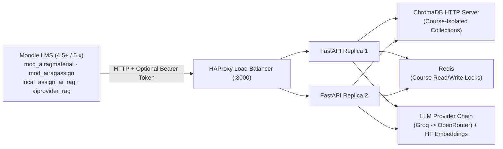

# Moodle RAG Essay Grader

An open-source **Retrieval-Augmented Generation (RAG)** essay and short-answer grading system integrated with **Moodle LMS**. Teachers upload course materials (PDF, PPTX, DOCX, TXT) directly in Moodle, which are chunked, embedded with `BAAI/bge-m3`, and stored per course in ChromaDB. When students submit essay or quiz answers, the FastAPI RAG backend retrieves relevant material excerpts, evaluates answers against teacher-defined rubrics, and returns scores, criterion breakdowns, page-level citations, and confidence scores for human-in-the-loop teacher review.

## Architecture Overview



See [docs/architecture.md](docs/architecture.md) for the complete endpoint contract and plugin interaction details.

## Repository Structure

```text
moodle-rag-essay-grader/
├── backend/                  # FastAPI + ChromaDB + Redis + HAProxy RAG service (MIT)
├── moodle-plugins/           # Moodle 4.5+ / 5.x plugins (GPL-3.0-or-later)
│   ├── mod_airagmaterial/    # Course material upload & background vectorization activity
│   ├── mod_airagassign/      # AI RAG essay/quiz assignment with HITL teacher review
│   ├── local_assign_ai_rag/  # Optional integration for Moodle standard mod_assign
│   └── aiprovider_rag/       # Moodle Core AI subsystem provider configuration
├── scripts/
│   └── build-plugins.sh      # Packages Moodle-ready ZIP archives into dist/
├── docs/                     # Architecture, deployment, and Moodle setup guides
└── .github/workflows/ci.yml  # Python tests, PHP lint, and ZIP build verification
```

## Quick Start

### 1. Start the Backend Stack (Docker Compose)

```bash
cd backend
cp .env.example .env
# Edit .env to set GROQ_API_KEY / OPENROUTER_API_KEY, HUGGINGFACE_API_TOKEN,
# and optionally API_AUTH_TOKEN for Bearer authentication.
docker compose up -d --build --remove-orphans
curl -fsS http://127.0.0.1:8000/health
```

### 2. Build and Install Moodle Plugins

Build the installable plugin `.zip` files:

```bash
./scripts/build-plugins.sh
```

This generates four archives in `dist/` with the exact root folder names Moodle expects:

1. `dist/airagmaterial.zip` (`airagmaterial/`) — install **before** `mod_airagassign`
2. `dist/airagassign.zip` (`airagassign/`)
3. `dist/aiprovider_rag.zip` (`rag/`) — install **before** `local_assign_ai_rag`
4. `dist/local_assign_ai_rag.zip` (`assign_ai_rag/`)

Then configure `Server URL` (and `API Key` if `API_AUTH_TOKEN` is set in `backend/.env`) in each plugin's Moodle admin settings. See [docs/moodle-setup.md](docs/moodle-setup.md) for full details.

## Testing & Verification

```bash
# Run backend unit tests
make test PYTHON=python3

# Lint all Moodle plugin PHP files
make lint-php

# Build and verify Moodle ZIP archives
make build-plugins
```

## Documentation

- [Product Requirements Document (PRD)](docs/PRD.md)
- [Architecture & API Contract](docs/architecture.md)
- [Production Deployment Guide](docs/deployment.md)
- [Moodle Plugin Setup & Configuration](docs/moodle-setup.md)
- [Contributing Guidelines](CONTRIBUTING.md)
- [Security Policy](SECURITY.md)

## License

- **`backend/`**, **`scripts/`**, and **`docs/`** are licensed under the [MIT License](backend/LICENSE).
- **`moodle-plugins/`** are licensed under the [GNU GPL v3.0 or later](moodle-plugins/LICENSE), as required by Moodle.

