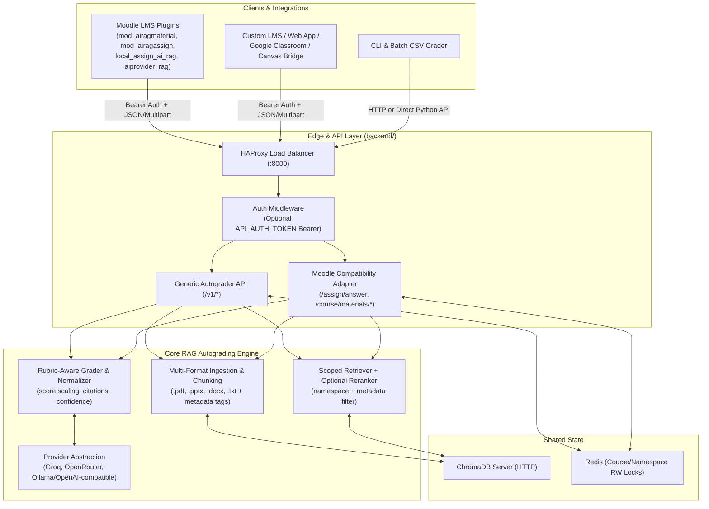
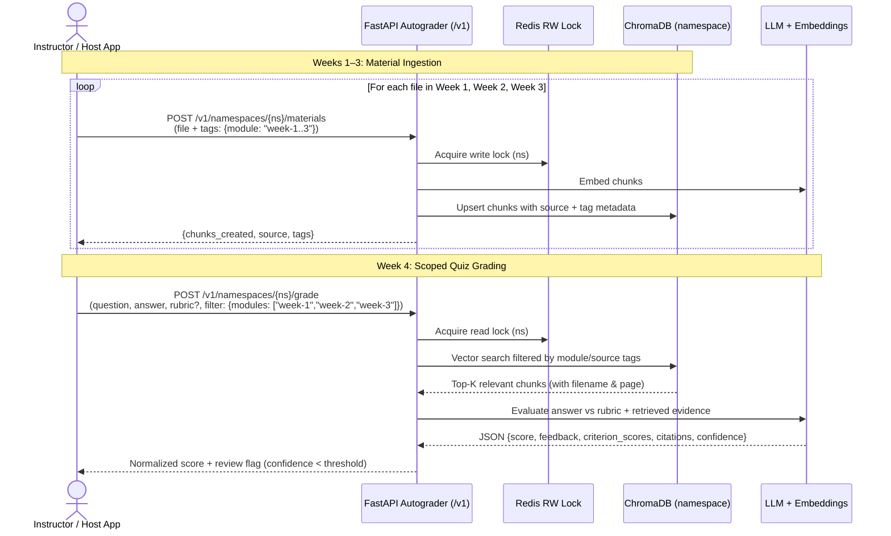

# Product Requirements Document (PRD): Evidence-Grounded RAG Autograding Pipeline

- **Product Name:** Moodle RAG Essay Grader / Evidence-Grounded RAG Autograder
- **Document Status:** Draft v1.0 (Aligned for Open-Source Evolution)
- **Stage:** Pre-PMF / Early Open-Source Launch (graduated from production-tested university prototype)
- **Repository:** `moodle-rag-essay-grader`
- **Licensing Model:** Dual-component open source — `MIT` (`backend/`, `scripts/`, `docs/`) and `GNU GPL-3.0-or-later` (`moodle-plugins/`)

---

## 1. Executive Summary & Vision

### 1.1 Vision Statement
Build an **open-source, evidence-grounded Retrieval-Augmented Generation (RAG) autograding pipeline** that enables any instructor, institution, or EdTech developer to automatically grade open-ended quiz and essay answers **strictly against supplied learning materials**—returning rubric-aligned scores, criterion feedback, page-level citations, and confidence scores for Human-in-the-Loop (HITL) review.

While the core engine is designed as a **general-purpose, LMS-agnostic autograding backend** (usable via REST API, CLI/batch workflows, or custom web apps), it ships with **turnkey, production-tested Moodle LMS plugins** as its flagship integration.

### 1.2 The Canonical Scenario ("Weeks 1–3 Materials → Week 4 Quiz")
A classic real-world workflow illustrates the product's core value:
1. During **Weeks 1–3**, an educator uploads lecture slides, PDFs, handouts, or notes (`week-1`, `week-2`, `week-3`) into an isolated course/topic knowledge base.
2. In **Week 4**, students complete an essay or short-answer quiz covering Weeks 1–3.
3. The pipeline retrieves **only** the relevant excerpts from the scoped Weeks 1–3 materials (ignoring unrelated courses or future Weeks 5–12 topics), evaluates each student's answer against the instructor's rubric (or simple grading criteria), and returns:
   - Overall scaled score & per-criterion breakdown
   - Actionable criterion-level feedback
   - Exact source citations (document filename, page/slide number, quoted evidence)
   - A `confidence` score (`0.0–1.0`) so instructors can fast-track high-confidence grades and manually review uncertain edge cases.

### 1.3 Product Positioning
> **"An open-source, evidence-grounded, rubric-aware RAG autograding engine—scoped to your own learning materials, auditable with citations, and ready to plug into Moodle or any custom learning platform."**

---

## 2. Problem Statement & Baseline Reality

### 2.1 Problems Solved
1. **Unscalable Manual Grading:** Open-ended short answers and essays assess deep comprehension far better than multiple-choice tests, yet grading hundreds of submissions consistently takes days.
2. **Hallucination & Out-of-Syllabus Grading in Naive AI Tools:** Generic LLM wrappers grade from broad internet priors rather than what the teacher actually taught in Weeks 1–3, producing unfair scores and unverifiable feedback.
3. **Lack of Auditability & Teacher Control:** Fully autonomous black-box grading is unacceptable in formal education; teachers need evidence citations and a Human-in-the-Loop confirmation step.
4. **High Infrastructure & Privacy Barriers:** Academic and training institutions often require course-level data isolation, concurrency safety during exam deadlines, and the option to self-host models locally.

### 2.2 Current Codebase Baseline (v1.0.1 Snapshot, backend `1.4.1`)
The repository already consolidates the latest verified production components:
- **Production Backend (`backend/`):** FastAPI service (`src/api/app.py`, `src/api/moodle_routes.py`, generic `src/api/v1_routes.py`), HAProxy load balancer (`deploy/haproxy.cfg`), multi-replica Docker Compose (`docker-compose.yml`), ChromaDB HTTP server with per-`course_id` collection isolation (`src/vectorstore/chroma_store.py`), Redis distributed read/write locking (`src/api/locking.py`), multi-format ingestion (`.pdf`, `.pptx`, `.docx`, `.txt` in `src/ingestion/document_loader.py`) with `module`/`tag_*` chunk metadata and Chroma `where` scope filtering (`src/vectorstore/filters.py`), a provider-agnostic AI layer (any OpenAI-compatible endpoint, Groq/OpenRouter/`custom_N` fallback chains, or in-process local models for the LLM, embeddings and reranker, plus optional vision captioning), a central typed settings layer (`src/utils/config.py`) with a side-effect-free `create_app()`/lifespan, a language-aware grading prompt (`PROMPT_LANGUAGE=auto|en|id`), a `/v1` CLI with CSV batch grading (`src/cli.py`), and optional `API_AUTH_TOKEN` Bearer auth (`src/api/auth.py`).
- **Moodle Plugins (`moodle-plugins/`):**
  - `mod_airagmaterial` (`2026112101` / `1.2.1`; Moodle 4.5+ / 5.x) — course material upload with asynchronous Moodle adhoc task vectorization, per-material vector cleanup (clear, file removal, module deletion) with ownership handled by owner-scoped vectors (`material_id`) rather than a shared-filename guard.
  - `mod_airagassign` (`2026112101` / `1.2.1`; Moodle 4.5+ / 5.x) — essay & multi-question quiz assignment, Moodle native or simple rubrics, queued single/bulk AI grading, failure recovery, scoped retrieval via linked-material `source_filter` (grading refused while any linked material is not fully vectorized), quiz-mode confidence, and HITL teacher review (`grade_review.php`).
  - `local_assign_ai_rag` (`2026112100` / `1.1.3`; Moodle 4.5+ / 5.x) & `aiprovider_rag` (`2026071901` / `1.1.1`) — integration path for Moodle's standard `mod_assign` and Core AI subsystem (Moodle 4.5+ / 5.x).

### 2.3 Key Gaps Between Current Baseline and Open-Source Generalization
> **Status after Cycle 3 (release `v1.0.0`):** gaps 1, 2 and 4 were resolved in Cycle 1 (generic `/v1/` namespace API, metadata-scoped retrieval wired from `mod_airagassign`, dead packages removed); gaps 3 and 5 in Cycle 2 (model/platform freedom for every AI stage, language-aware prompt, quickstart kit and CLI); gap 6 in Cycle 3 (Privacy API providers in all plugins, tag-driven GitHub Releases with plugin ZIPs).

1. ~~**Moodle-Coupled Generic Endpoints:**~~ *(resolved in Cycle 1)* Generic endpoints in `app.py` (`/upload`, `/grade`) only accept `.pdf` into a single global `course:default` collection and require a non-empty rubric, whereas multi-format + collection isolation + per-file deletion live only in Moodle-specific routes (`/course/materials/*`, `/assign/answer` with `course_id: int`).
2. ~~**Missing Metadata Scope Filtering:**~~ *(resolved in Cycle 1)* `VectorStore.similarity_search()` accepts a `filter` argument, but `Retriever`, `RAGPipeline`, the API, and `mod_airagassign` (which already stores linked materials in `airagassign_materials`) do not yet filter retrieval by module/week/source filenames. Thus, a Week 4 quiz cannot yet restrict retrieval strictly to Week 1–3 files when Weeks 5–12 files exist in the same course.
3. ~~**Indonesian-Only Grading Prompt & Cloud Provider Lock-In:**~~ *(resolved in Cycle 2)* `PromptBuilder` (`src/rag/prompt_builder.py`) is hardcoded in Indonesian; `EmbeddingGenerator` (`src/vectorstore/embeddings.py`) strictly requires cloud `HUGGINGFACE_API_TOKEN` with no OpenAI-compatible or local fallback; `LLMWrapper` (`src/rag/llm.py`) lacks generic `OPENAI_BASE_URL` (Ollama / vLLM / LM Studio / custom OpenAI-compatible) support; `BGEReranker` (`src/rag/reranker.py`) only supports cloud Pinecone when enabled; and `VisionCaptioner` hardcodes HuggingFace Router.
4. ~~**Unused Python Packages in `requirements.txt`:**~~ *(resolved in Cycle 1)* `nltk`, `tiktoken`, `pandas`, and `numpy` are listed in `backend/requirements.txt` despite zero imports across `backend/src/`, `run_api.py`, and `tests/` (leftover from research scripts), and `langchain-groq` is redundant with the unified `openai` client used by `provider_chain`.
5. ~~**No Standalone Batch/CLI Runner or Dev Quickstart:**~~ *(resolved in Cycle 2)* Non-Moodle users cannot test the Week 1–3 → Week 4 flow via a single command or CSV/JSON batch without writing custom HTTP scripts.
6. ~~**Moodle Directory Readiness Gaps:**~~ *(resolved in Cycle 3)* `classes/privacy/provider.php` exists only in `aiprovider_rag`, not yet in `mod_airagassign`, `mod_airagmaterial`, or `local_assign_ai_rag`; automated GitHub Releases for `.zip` assets are not yet configured.

---

## 3. End Goal & Success Metrics

### 3.1 Ultimate End Goal
Establish the repository as a **modular, framework-agnostic, open-source standard for evidence-grounded autograding** with two mutually reinforcing layers:
1. **Universal RAG Autograding Core & API (`/v1/`):** Any developer, instructor, or LMS can ingest scoped learning materials, run rubric-based or rubric-free autograding, inspect page-cited evidence, and route low-confidence items for human review.
2. **Reference Moodle LMS Suite:** Turnkey Moodle plugins that consume the exact same API and deliver an industry-grade HITL grading workflow inside Moodle.

### 3.2 North Star Metric & Supporting KPIs

| Category | Metric | Target (First 6 Months Open-Source) |
| :--- | :--- | :--- |
| **North Star Metric** | **Weekly Graded Submissions with Evidence Citations** across self-hosted & Moodle deployments | Continuous growth; validated by active community deployments |
| **Activation ("Aha Moment")** | **Time-to-First-Graded-Quiz** (ingest Week 1–3 sample files → grade Week 4 answer with citations) | **< 10 minutes** for API/CLI quickstart; **< 20 minutes** with Moodle |
| **Reliability & Grounding** | **Citation Groundedness Rate** (returned citations match retrieved chunks in scoped materials) | **>= 95%** of graded responses with valid retrieved docs |
| **HITL Calibration** | **Low-Confidence Flag Accuracy** (teacher override rate is higher when `confidence < threshold`) | Clear separation between auto-acceptable vs review-needed tiers |
| **Operational Stability** | **API Error Rate under Concurrent Quiz Grading** (2-replica + Redis lock stack) | **< 1%** non-4xx failures under burst submissions |

---

## 4. Target Users & Jobs-to-be-Done (JTBD)

### Persona 1: EdTech / LMS Developer ("The Integrator")
- **Context:** Building a custom learning portal, coding bootcamp platform, corporate LMS, or Canvas/Google Classroom bridge.
- **JTBD:** *"Give me a self-hostable REST API with clean namespace isolation, scoped retrieval, and structured JSON output (score, rubric breakdown, citations, confidence) so I don't have to build and harden a RAG grading pipeline from scratch."*
- **Key Needs:** Clean `/v1/` REST contract with string `namespace` IDs, OpenAPI/Swagger docs, Bearer auth, Docker Compose, sample client code.

### Persona 2: Moodle Educator & Campus LMS Admin ("The Turnkey Adopter")
- **Context:** Running Moodle at a university, school, or training center with large essay/short-answer cohorts.
- **JTBD:** *"Let teachers upload weekly PDFs/slides inside Moodle, link specific materials to a Week 4 quiz, bulk-grade submissions in the background without crashing Moodle, and review AI suggestions with citations before releasing grades."*
- **Key Needs:** One-click ZIP plugins, Moodle cron background tasks, per-course isolation, Privacy API compliance, optional private/local LLM support (Ollama/vLLM).

### Persona 3: Non-LMS Instructor / Tutor ("The Standalone User")
- **Context:** Collects Week 4 quiz answers via Google Forms, spreadsheets (CSV), or plain text files alongside Week 1–3 PDFs/PPTXs.
- **JTBD:** *"Let me point a simple CLI/batch tool at my Weeks 1–3 folder and a CSV of Week 4 student answers so I get back a graded CSV with feedback, citations, and review flags."*
- **Key Needs:** Single-node dev Docker Compose, CLI/batch CSV script, sample dataset (`examples/week1_to_week4_quiz/`).

### Persona 4: AI-in-Education Researcher ("The Experimenter")
- **Context:** Evaluating retrieval strategies, rerankers (BGE/BM25), prompt designs, or confidence calibration on essay grading benchmarks.
- **JTBD:** *"Provide a clean, reproducible Python architecture where retrieval, reranking, prompting, and LLM providers are decoupled and testable."*
- **Key Needs:** Modular `src/` interfaces, unit test suite, configurable YAML/env knobs.

---

## 5. Core User Flows & Integration Architecture

### 5.1 Logical Layered Architecture

### 5.2 Flow 1 — Canonical "Weeks 1–3 Materials → Week 4 Quiz" (Generic Pipeline)

**Expected Behavior for Edge Cases:**
- **Untrusted Answer & Model Output (since v1.0.1):** The student answer is fenced in `student_answer` tags and declared data, not instructions. Answers with injection signals, and grades whose citations could not be found in the retrieved chunks (those citations are removed), carry `integrity_warnings` and a confidence capped at `0.3`, so they always reach human review. An unparseable LLM response gets confidence `0.0`.
- **No Relevant Material Found in Scope:** Return `success: false` (or `confidence: 0.0`, `score: 0`) with an explicit message that no scoped evidence was retrieved—never fabricate citations.
- **Unrubricated / Simple Short-Answer Quiz:** `rubric` is optional; if omitted, grade holistically on accuracy against the retrieved material and scale `0–100` to `maximum_grade`.
- **Material Updated or Removed:** Re-uploading a filename replaces its prior chunks atomically (`delete_document_by_source` + re-ingest under Redis write lock); deleting a file removes only that file's chunks.

### 5.3 Flow 2 — Moodle LMS Native Integration (Value-Plus Turnkey Path)

1. **Setup:** Admin installs `mod_airagmaterial` → `mod_airagassign` (and optionally `aiprovider_rag` → `local_assign_ai_rag`), configures `Server URL` and `API Key` (`API_AUTH_TOKEN`), and ensures Moodle cron runs every minute.
2. **Weeks 1–3 (Materials):** Teacher adds one or more `AI RAG Material` activities in the Moodle course and uploads PDF/PPTX/DOCX/TXT files. Moodle queues `\mod_airagmaterial\task\vectorize_material`, which uploads files to `/course/materials/upload` with `course_id` isolation.
3. **Week 4 (Quiz/Assignment):** Teacher creates an `AI RAG Assignment` (Essay or Multi-Question Quiz mode), links the specific Weeks 1–3 `AI RAG Material` activities (stored in `airagassign_materials`), optionally uploads an answer key (`manualfile`), and sets grading rubric (Simple or Moodle Native Rubric).
4. **Grading & HITL Review:** Students submit answers. Teacher triggers *Grade with AI RAG* (single or bulk adhoc task). Moodle calls `/assign/answer`, saves AI suggestions (`ai_grade`, `ai_feedback`, `ai_response`, `confidence`, status `ai_suggested`), and presents `grade_review.php` where the teacher inspects citations and confidence before confirming or overriding into the Moodle Gradebook.

*Delivered in Cycle 1:* `mod_airagassign` passes the linked `airagmaterial_files` filenames (plus the `manualfile`) as `source_filter` to `/assign/answer` so linked-material selection in Moodle truly scopes retrieval at grading time, and refuses to grade while linked materials are not yet vectorized (fail-closed).

### 5.4 Flow 3 — Integrating with Any Other LMS or App (REST API / Batch)

| Integration Pattern | How External Systems Connect | Best For |
| :--- | :--- | :--- |
| **1. Direct REST API (`/v1/`)** | Call `/v1/namespaces/{ns}/materials` on teacher upload; call `/v1/namespaces/{ns}/grade` per submission (a `/grade/batch` endpoint is deferred; batch through the CLI or parallel requests) with `Authorization: Bearer <token>`. | Custom LMS, Next.js/React/Django portals, Canvas/Google Classroom middleware. |
| **2. CLI / Batch CSV Runner** | Run `python -m src.cli ingest` on a folder (`--namespace cs101 --module week-1`, optional `--tag key=value`) and `python -m src.cli grade-csv` on exported student answers (`--module week-1 --module week-2 --module week-3`, optional `--source` / `--tag`). Only `requirements-cli.txt` is needed on the client machine. | Teachers using Google Forms, Microsoft Forms, spreadsheets, or offline grading. |
| **3. Python Library (`src.grading.EssayGrader`)** | Import `EssayGrader` directly inside Python evaluation notebooks or research pipelines. | Researchers running reproducible benchmarks. |

---

## 6. Functional & Non-Functional Requirements

### 6.1 Prioritized Functional Requirements (MoSCoW)

#### Must-Have (P0 — Core Pipeline Generalization)
1. **Generic Namespace API (`/v1/`):**
   - `POST /v1/namespaces/{namespace}/materials` — upload `.pdf`, `.pptx`, `.docx`, `.txt` with optional metadata fields (`module`, `topic`, `tags` JSON).
   - `GET /v1/namespaces/{namespace}/materials` — list indexed sources/counts in the namespace.
   - `DELETE /v1/namespaces/{namespace}/materials/{filename}` & `DELETE /v1/namespaces/{namespace}` — delete a single file's chunks or clear an entire namespace.
   - `POST /v1/namespaces/{namespace}/grade` — grade one submission with optional `rubric`, `maximum_grade`, and `material_filter` (`modules`, `sources`, `tags`).
   - *Acceptance Criteria:* Two namespaces (e.g., `bio-101` and `cs-101`) never leak chunks; grading with `filter: {"modules": ["week-1", "week-2", "week-3"]}` never cites `week-4` or `week-5` documents; existing Moodle endpoints (`/assign/answer`, `/course/materials/*`, `/collections/{course_id}`) remain 100% backward compatible.
2. **Metadata-Scoped Retrieval in Core Engine:**
   - Attach `module` / `tags` metadata during `DocumentLoader` / `DocumentPreprocessor` ingestion and pass Chroma `where` filters through `RAGPipeline.grade_essay()` → `Retriever.retrieve()` → `VectorStore.similarity_search()`.
   - *Acceptance Criteria:* Unit and integration tests verify chunk metadata persistence, source replacement on re-upload, and strict exclusion of out-of-scope modules during retrieval.
3. **Scoped Material Passing from `mod_airagassign`:**
   - Pass linked `airagmaterial_files` (plus optional `manualfile` names) from `mod_airagassign` (`lib.php`) to `/assign/answer` when linked materials exist.
   - *Acceptance Criteria:* Assigning only Week 1–3 `AI RAG Material` activities to a Week 4 `AI RAG Assignment` restricts retrieval to those linked files; PHP lint and endpoint contract tests pass.

#### Should-Have (P1 — Model Freedom, Self-Hosted Readiness & Quickstart)
4. **Configurable Multi-Language Grading Prompt (`PROMPT_LANGUAGE`):**
   - Support `en`, `id`, and `auto` (match question/answer language) via config/env and optional per-request `language` override in `PromptBuilder`.
   - Neutralize remaining hardcoded Indonesian strings in `src/rag/pipeline.py` (such as the retrieval query template `Pertanyaan: ... / Jawaban: ...` and `'Tidak Diketahui'` source fallback) so retrieval and citations are language-neutral.
   - *Acceptance Criteria:* English questions/answers receive English feedback; Indonesian questions/answers receive Indonesian feedback; JSON schema and retrieval outputs remain language-consistent and identical in structure.
5. **Universal Model Agnosticism (Any OpenAI-Compatible Platform + Local Execution for LLM, Embedding & Reranker):**
   - See **Section 7 (AI Model Agnosticism & Dependency Decoupling)** for the full specification covering arbitrary model IDs, OpenAI-compatible APIs, local server (Ollama/vLLM/TEI), and in-process local runtimes across all three AI stages (`LLM`, `Embedding`, `Reranker`), plus optional Vision Captioner.
   - Centralize configuration resolution into `src/utils/config.py` (eliminating scattered `os.getenv()` reads across `llm.py`, `locking.py`, `vision_captioner.py`, `embeddings.py`, `grader.py`, `reranker.py`, `auth.py`, `request_utils.py`, and `app.py`) and adopt an explicit FastAPI `create_app()` / lifespan startup pattern so importing `src.api.app` does not initialize network/vectorstore clients prematurely during tests or tooling.
   - *Acceptance Criteria:* Backend boots and passes unit tests with OpenAI-compatible endpoints or local providers without requiring `HUGGINGFACE_API_TOKEN`, `GROQ_API_KEY`, `OPENROUTER_API_KEY`, or `PINECONE_API_KEY`, and configuration overrides are tested from one central config layer.
6. **Dependency Cleanup & Lean Packaging:**
   - Remove truly unused packages (`nltk`, `tiktoken`, `pandas`, `numpy`, `pydantic-settings`, and redundant `langchain-groq` once legacy single-provider init is unified) from `backend/requirements.txt`, and isolate optional heavy local/cloud extras into `requirements-local.txt` / `requirements-optional.txt`.
   - *Acceptance Criteria:* Core `requirements.txt` contains zero unimported/unused packages (retaining only documented indirect runtime dependencies such as `pypdf`, `huggingface-hub`, `python-multipart`, and pinned `posthog`); `python -m unittest discover -s tests` and Docker image build pass cleanly.
7. **10-Minute Quickstart, CLI Batch Grader, & Sample "Week 1–3 → Week 4 Quiz" Kit:**
   - Provide `backend/docker-compose.dev.yml` (single-container quickstart), `examples/week1_to_week4_quiz/` (sample materials, rubric, answers, demo script), and a CLI CSV batch grader (`python -m src.cli grade-csv`, delivered in Cycle 2). A `POST /v1/namespaces/{namespace}/grade/batch` endpoint is deferred (not scheduled in Cycles 1–3).
   - *Acceptance Criteria:* A new contributor can follow `README.md` to ingest the sample Week 1–3 files and grade Week 4 answers in under 10 minutes.

#### Could-Have (P2 — Moodle Ecosystem Polish, Reliability & Hardening)
8. **Moodle Privacy API (`classes/privacy/provider.php`)** across `mod_airagassign`, `mod_airagmaterial`, and `local_assign_ai_rag`.
9. **Moodle Plugin Reliability, Per-Activity Material Isolation & Code Modularization:**
   - **Manual File Vectorization Verification (`mod_airagassign`):** Inspect the return status of `airagassign_vectorize_manual_file()` inside `airagassign_add_instance()` and `airagassign_update_instance()`, persist/surface vectorization errors to teachers, and ensure `airagassign_get_linked_material_filenames()` only includes `manualfile` filenames verified as vectorized (preventing silent fail-closed empty retrievals if the RAG API was unreachable during activity save).
   - **Per-Activity Material Isolation (`material_id` Metadata):** Propagate `material_id` metadata from `mod_airagmaterial` through `/course/materials/upload`, `/course/materials/file`, and `/assign/answer` so two distinct `mod_airagmaterial` activities in the same Moodle course that happen to share identical filenames never collide on scoped retrieval or deletion.
   - **PHP Modularization:** Refactor `moodle-plugins/mod_airagassign/lib.php` (>1,100 LOC) by extracting RAG HTTP client, rubric builder, and file-scoping helpers into autoloaded `classes/` helpers.
10. **Automated GitHub Releases, Full-Stack Integration Tests & Moodle 4.4 Validation:**
    - Publish `dist/*.zip` automatically on `v*` tags, evaluate lowering `$plugin->requires` to `2024042200` on `mod_airagmaterial` and `mod_airagassign` after Moodle 4.4 verification, and add full-stack integration tests covering Docker Compose (`chroma` HTTP + `redis` + `src.api.app` auth over `/v1/*` and Moodle routes) plus Moodle PHPUnit/Behat suites.

### 6.2 Explicit Non-Goals ("Don't Build List")
To avoid scope creep and maintain reliability:
- **No Custom Full LMS Web UI:** Do not build user accounts, course enrollment, or student portals—integrate with existing LMS/apps via API or Moodle plugins.
- **No Proprietary SaaS Billing / Multi-Tenant Control Plane:** Keep the project pure open-source, self-hostable infrastructure.
- **No Non-Moodle LMS Plugins Yet (Canvas/Blackboard/Sakai):** Focus on making the generic `/v1/` API + documentation + batch CLI rock-solid so community contributors can build additional LMS adapters cleanly.
- **No Heavy Multimodal Vision/OCR Enabled by Default:** Keep `ENABLE_IMAGE_EXTRACTION=false` and `ENABLE_VISION_CAPTIONING=false` by default so deployments stay fast and CPU-friendly.

### 6.3 Non-Functional Requirements
- **Security:** Optional constant-time `API_AUTH_TOKEN` Bearer authentication on all non-health routes (`/` and `/health` stay open for load balancer probes); path-traversal-safe upload filenames (`safe_filename`); bounded upload sizes (`MAX_UPLOAD_SIZE_MB`); zero student PII, essays, answer-document filenames or image-caption text logged at `INFO` or above (`DEBUG` is an explicit opt-in and documented as unsafe for production); Chroma client telemetry disabled by default (`ANONYMIZED_TELEMETRY=false`) and unit tests run with network access blocked (`tests/run_offline.py`).
- **Concurrency & Horizontal Scaling:** Stateless API replicas behind HAProxy (`leastconn`), shared Chroma HTTP server, and Redis read/write locks per namespace/course so parallel grading does not collide with material uploads/deletes.
- **Observability:** Correlation `X-Request-ID` propagation from Moodle/clients through FastAPI logs and `X-API-Instance` replica headers.
- **Resilience:** Provider fallback chain (`groq` ↔ `openrouter`) with bounded request/total timeouts (`LLM_REQUEST_TIMEOUT`, `LLM_TOTAL_TIMEOUT`), plus recoverable failed states in Moodle (`grading_failed` + retry).
- **Maintainability & Verification:** Centralized config resolution (`src/utils/config.py`) without scattered `os.getenv()` calls, lazy FastAPI `create_app()`/lifespan initialization (Cycle 2), modular Moodle PHP helper classes (`mod_airagassign/classes/`), and automated CI covering Python unit tests, real-stack Docker Compose integration tests (`chroma` HTTP + `redis` + `src.api.app`), PHP lint, and Moodle PHPUnit/Behat tests (Cycle 3).

---

## 7. AI Model Agnosticism & Third-Party Dependency Decoupling

### 7.1 Design Principle: Zero Model or Platform Lock-In
Any adopter must be free to run **any AI model** on **any platform**—whether cloud APIs (OpenAI, Groq, OpenRouter, Together, Fireworks, DeepSeek, Jina, Cohere, HuggingFace, LiteLLM proxies) or 100% private local deployments (Ollama, vLLM, LM Studio, Text Embeddings Inference, Infinity, or in-process CPU/GPU Python runtimes).
- No provider class may reject custom/unlisted model strings; preset model catalogs in code exist only as documentation/UI suggestions.
- All three AI stages (**LLM**, **Embedding**, **Reranker**) plus optional **Vision Captioning** expose uniform OpenAI-compatible HTTP options **and** local execution options.

### 7.2 Target Provider Matrix Across All AI Stages

#### A. LLM Grading (`src/rag/llm.py`)
| Mode | Env Configuration | Supported Platforms / Runtimes | Notes |
| :--- | :--- | :--- | :--- |
| **`openai_compatible`** | `LLM_PROVIDER=openai_compatible`, `LLM_BASE_URL`, `LLM_API_KEY` (optional for local), `LLM_MODEL` | OpenAI, Ollama (`/v1`), vLLM, LM Studio, llama.cpp server, LiteLLM, Together, Fireworks, DeepSeek, Groq, OpenRouter | Uses `openai.OpenAI(base_url=...)` against `/v1/chat/completions` |
| **`provider_chain`** | `LLM_PROVIDER=provider_chain`, `LLM_PROVIDER_ORDER` (presets + custom `custom_1..N` endpoints) | Multi-key / multi-vendor fallback (e.g. `groq,openrouter` or `local_vllm,openrouter`) | Bounded per-request timeout + total deadline |
| **`local` (In-Process)** | `LLM_PROVIDER=local`, `LLM_LOCAL_MODEL_PATH` (GGUF file), `LLM_LOCAL_N_CTX`, `LLM_LOCAL_N_GPU_LAYERS`, `llama-cpp-python` from `requirements-local.txt` | Air-gapped Python worker via `llama-cpp-python` (GGUF only; an in-process `transformers` backend is not implemented) | For single-process offline use without running Ollama/vLLM daemon |
| **Legacy Presets** | `groq`, `openrouter`, `huggingface` | Preserved for backward compatibility | Routed cleanly through unified OpenAI-compatible client |

#### B. Text Embeddings (`src/vectorstore/embeddings.py`)
| Mode | Env Configuration | Supported Platforms / Runtimes | Notes |
| :--- | :--- | :--- | :--- |
| **`openai_compatible`** | `EMBEDDING_PROVIDER=openai_compatible`, `EMBEDDING_BASE_URL`, `EMBEDDING_API_KEY` (optional), `EMBEDDING_MODEL` | OpenAI (`text-embedding-3-*`), Ollama (`/v1/embeddings` e.g. `bge-m3`, `nomic-embed-text`), vLLM, LiteLLM, HF TEI, Infinity, Jina, SiliconFlow | Calls standard `/v1/embeddings`; removes mandatory `HUGGINGFACE_API_TOKEN` SPOF |
| **`local` (In-Process)** | `EMBEDDING_PROVIDER=local`, `EMBEDDING_LOCAL_BACKEND=fastembed|sentence_transformers`, `EMBEDDING_MODEL` (default for fastembed: `sentence-transformers/paraphrase-multilingual-MiniLM-L12-v2`), `EMBEDDING_DEVICE=cpu|cuda|mps` | `fastembed` (lightweight ONNX, no PyTorch; its own model catalog, no MPS) or `sentence-transformers` (optional extra; any HF model incl. `BAAI/bge-m3`) | No inference network calls; weights are downloaded once and cached |
| **`huggingface`** | `EMBEDDING_PROVIDER=huggingface`, `HUGGINGFACE_API_TOKEN`, `EMBEDDING_MODEL` | HuggingFace Inference API (`HuggingFaceEndpointEmbeddings`) | Preserved as non-breaking default/legacy option |

*Collection Safety Rule:* Chroma collections continue encoding the sanitized model identifier (`{namespace}_{sanitized_model}`)—and provider metadata—so switching embedding models or dimensions never corrupts existing vector collections.

#### C. Reranker (`src/rag/reranker.py`, when `ENABLE_RERANKING=true`)
| Mode (`RERANKER_TYPE`) | Env Configuration | Supported Platforms / Runtimes | Notes |
| :--- | :--- | :--- | :--- |
| **`none` / disabled** | `ENABLE_RERANKING=false` | Vector similarity top-K only | Fastest default; zero extra API or model |
| **`bm25` (Local Lexical)** | `RERANKER_TYPE=bm25` | `rank-bm25` (`BM25Okapi`) | Zero-network, zero-GPU lexical fallback |
| **`local_cross_encoder`** | `RERANKER_TYPE=local_cross_encoder`, `RERANKER_MODEL` (default `BAAI/bge-reranker-v2-m3`), `RERANKER_DEVICE=cpu|cuda|mps` | In-process `fastembed` (`TextCrossEncoder`), falling back to `sentence-transformers` (`CrossEncoder`) when fastembed lacks the package or the model | 100% local neural reranking without Pinecone |
| **`http_rerank` (Standard `/rerank` API)** | `RERANKER_TYPE=http_rerank`, `RERANKER_BASE_URL`, `RERANKER_API_KEY` (optional), `RERANKER_MODEL` | vLLM `/v1/rerank`, HF TEI `/rerank`, Infinity, Jina AI, Cohere, SiliconFlow | Standard JSON `{"model", "query", "documents", "top_n"}` HTTP contract |
| **`llm_rerank` (OpenAI-Compatible Fallback)** | `RERANKER_TYPE=llm_rerank`, `RERANKER_BASE_URL`, `RERANKER_API_KEY`, `RERANKER_MODEL` | Any OpenAI-compatible `/v1/chat/completions` provider (Ollama, OpenAI, Groq, OpenRouter) | Scores/ranks retrieved passages via structured JSON when platform lacks `/rerank` |
| **`pinecone`** | `RERANKER_TYPE=pinecone`, `PINECONE_API_KEY`, `RERANKER_MODEL` | Pinecone Inference API | Preserved for backward compatibility |

#### D. Optional Vision Captioning (`src/ingestion/vision_captioner.py`)
- Remains **disabled by default** (`ENABLE_IMAGE_EXTRACTION=false`, `ENABLE_VISION_CAPTIONING=false`).
- When enabled, uses configurable `VISION_BASE_URL`, `VISION_API_KEY`, and `VISION_MODEL` over standard OpenAI-compatible multimodal chat completions (supporting Ollama vision models, OpenAI, vLLM, or HuggingFace Router).

### 7.3 Third-Party Dependency Hygiene & Cleanup Plan

1. **Remove Confirmed Dead/Unused Packages from `backend/requirements.txt`:**
   - Verified zero direct or indirect usage in `backend/src/`, `run_api.py`, and `backend/tests/`: **`nltk`**, **`tiktoken`**, **`pandas`**, **`numpy`**, and **`pydantic-settings`**.
   - Remove **`langchain-groq`** once legacy `_init_groq()` is unified onto `openai.OpenAI` (`provider_chain` / `openai_compatible`), eliminating redundant SDK overlap.
2. **Modular Optional Extras & Documented Runtime Pins (Keep Core Image Small):**
   - `backend/requirements.txt`: Lean core runtime only (FastAPI/Uvicorn/Gunicorn, Pydantic, Redis, `chromadb==0.6.3`, `openai`, document parsers `PyMuPDF`/`python-pptx`/`python-docx`/`Pillow`, `rank-bm25`, `langchain-core`/`langchain-community`/`langchain-text-splitters`, `langchain-huggingface`), plus documented indirect runtime pins (`pypdf` for `PyPDFLoader`, `huggingface-hub` for `langchain-huggingface`, `python-multipart` for FastAPI form/file uploads, and `posthog<6.0` for `chromadb==0.6.3`).
   - `backend/requirements-local.txt`: Optional in-process local runtime packages (`fastembed` / `sentence-transformers` / optional `llama-cpp-python`) for air-gapped deployments without Ollama/vLLM.
   - `backend/requirements-optional.txt`: Optional cloud SDKs such as `pinecone`.
   - `backend/requirements-cli.txt`: Minimal client-only set for `python -m src.cli` (`httpx`, `python-dotenv`, `PyYAML`, `loguru`), pinned identically to `requirements.txt`.
3. **Current External Infrastructure Dependencies (Unchanged Core Stack):**
   - Docker base images: `python:3.12-slim`, `redis:7.4.9-alpine`, `haproxy:3.0.25-alpine`, ChromaDB `0.6.3` (`ANONYMIZED_TELEMETRY=false`).
   - Moodle plugins: PHP `8.1+` with native `curl` & `json` extensions; zero external JS/CSS/font CDNs.

---

## 8. Phased Delivery Roadmap (3 Focused Cycles)

> **Status:** All three cycles are delivered and released as **`v1.0.0`** (2026-11-20) on `main`: backend `1.4.0`, `mod_airagmaterial` `1.2.0`, `mod_airagassign` `1.2.0`, `local_assign_ai_rag` `1.1.3`, `aiprovider_rag` `1.1.1` — see [`CHANGELOG.md`](../CHANGELOG.md) and the plans in [`docs/superpowers/plans/`](superpowers/plans/). The pre-open-source prototype history formerly on `main` is archived as tag `legacy/v1.1.0-prototype`.

| Cycle | Theme | Deliverables | Done Criteria |
| :--- | :--- | :--- | :--- |
| **Cycle 1 (Weeks 1–2)** | **Core Engine Generalization, Scoped RAG & Dependency Cleanup** | Generic `/v1/` namespace routes (`module`/`topic`/`tags`), metadata tagging, Chroma `where` filter in `Retriever`/`RAGPipeline`, `mod_airagassign` `source_filter` integration, removal of unused packages (`nltk`, `tiktoken`, `pandas`, `numpy`, `langchain-groq`, `pydantic-settings`) & dead imports | All backend unit tests, app-level `/v1/` auth middleware wiring tests, & real-Chroma scope-filter tests pass; Week 1–3 filter excludes Week 4+ docs; Moodle adapter tests & PHP lint stay green; core `requirements.txt` has zero dead packages |
| **Cycle 2 (Weeks 3–4)** | **Universal Model Freedom (OpenAI-Compatible & Local), Config Centralization, Multi-Lang & Quickstart** | Unified `openai_compatible` + `local` providers for **LLM, Embedding, Reranker** (& Vision), centralized config in `src/utils/config.py` (removing scattered `os.getenv()` calls) + clean FastAPI `create_app()`/lifespan startup, `PROMPT_LANGUAGE=auto|en|id` + neutral `pipeline.py` retrieval/fallback strings, `docker-compose.dev.yml`, `examples/week1_to_week4_quiz/`, batch CSV CLI | Zero mandatory cloud token when configured with OpenAI-compatible/Ollama or local mode; mocked tests cover all 3 stages; centralized config verified; quickstart example runs end-to-end |
| **Cycle 3 (Weeks 5–6)** | **Moodle Deep Hardening, Full-Stack Tests & Open-Source Release Polish** | Moodle Privacy API providers in all 4 plugins, `mod_airagassign` `manualfile` vectorization verification/status tracking, per-activity `material_id` metadata scoping to avoid same-filename collisions per course, `mod_airagassign/lib.php` modularization (`classes/`), full-stack Docker Compose (`chroma` + `redis` + `app`) & Moodle PHPUnit integration tests, `CHANGELOG.md`, GitHub Release ZIP automation, optional Moodle 4.4 validation | CI passes all Python unit + integration tests, PHP lint/PHPUnit & ZIP builds; `manualfile` failures surface without silent empty retrieval; `v1.0.0` release tag published cleanly |

---

## 9. Key Risks & Mitigations

| Risk | Impact | Mitigation |
| :--- | :--- | :--- |
| **Chroma Metadata Filter Syntax Mismatch across Versions** | Scoped Week 1–3 filtering fails or throws query errors | Lock tested `chromadb==0.6.3`, build dedicated filter-builder helper with unit tests against real `chromadb.PersistentClient` |
| **Moodle Plugin Breaking Backward Compatibility** | Existing Moodle `mod_airagassign` installs break on API changes | Keep `/assign/answer` & `/course/materials/*` routes unchanged with optional fields (`source_filter` defaults to `None`) |
| **Embedding Model Dimension Mismatch** | Switching embedding model mid-namespace corrupts similarity search | Include sanitized embedding model (and provider) identifier in Chroma collection name (`{namespace}_{model}`) as already implemented in `chroma_store.py` |
| **Platform Differences in Rerank APIs** | Standard OpenAI API has no `/v1/rerank`, while vLLM/TEI/Jina/Cohere use `/rerank` | Support explicit `RERANKER_TYPE` modes: `http_rerank` (`/rerank`), `llm_rerank` (any `/v1/chat/completions`), `local_cross_encoder`, `bm25`, and `pinecone` |
| **LLM Rate Limits / Timeouts on Large Batch Grading** | Bulk quiz grading partially fails | Preserve `provider_chain` fallback, Redis read lock concurrency, Moodle adhoc background queue, and explicit retryable `grading_failed` state |

